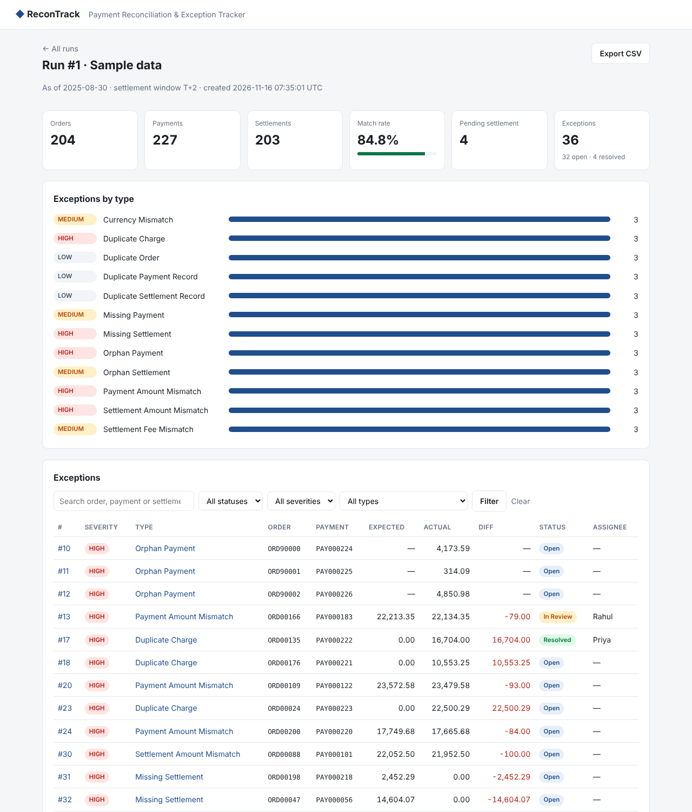
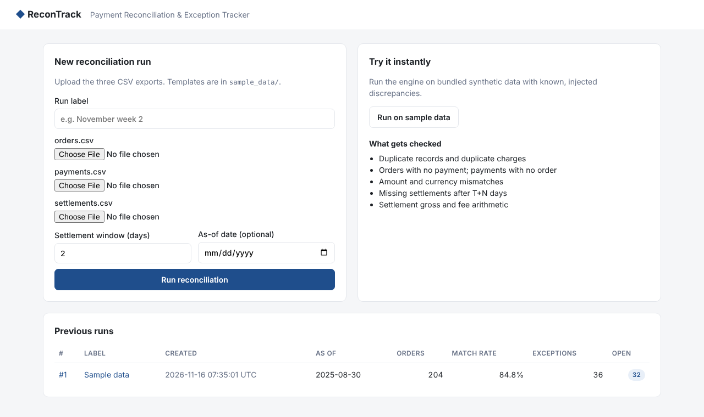
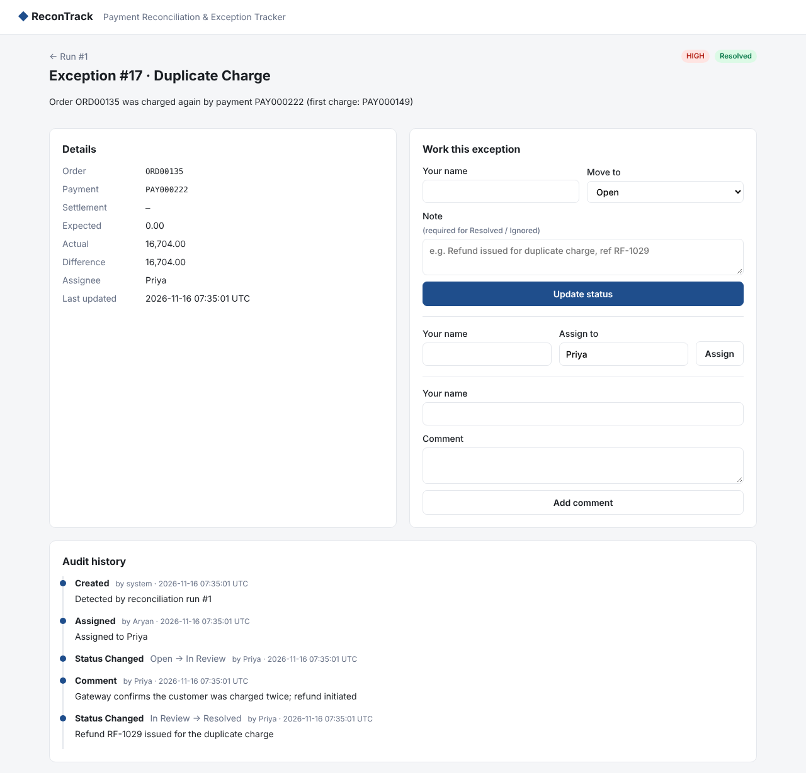

# ReconTrack: Payment Reconciliation & Exception Tracker

A Flask web app that reconciles **orders ↔ payments ↔ settlements** from CSV exports, detects 12 types of discrepancies (duplicate charges, missing settlements, amount mismatches and more), and gives operations teams a dashboard to investigate and resolve each exception with a full audit trail.



## Why this exists

Every business that takes online payments has three sources of truth that should agree but often don't:

| Source | Question it answers |
|---|---|
| **Orders** (your system) | What should the customer pay? |
| **Payments** (payment gateway) | What did the customer actually pay? |
| **Settlements** (bank / gateway payout) | What money actually reached the bank account? |

When they disagree, money is lost: a customer is charged twice, a payment never settles, or a fee is wrong. Finance teams usually catch this by hand in spreadsheets. ReconTrack automates the matching and turns every mismatch into a trackable exception.

## Features

- **Three-way matching engine** with 12 rules, configurable settlement window (T+N days) and amount tolerance
- **CSV validation** with line-numbered errors, Excel BOM handling, multiple date formats and thousands separators
- **Exception dashboard**: match rate, pending settlements, exceptions by type and severity, search and filters
- **Resolution workflow**: Open → In Review → Resolved / Ignored, with enforced transitions and mandatory notes when closing
- **Audit history**: every creation, assignment, status change and comment is logged with who and when
- **CSV export** of exceptions and a small **JSON API**
- **Synthetic data generator** that injects known discrepancies, used to measure the engine's accuracy

## Matching rules

| # | Exception | Severity | Rule |
|---|---|---|---|
| 1 | Duplicate Charge | HIGH | An order has more than one successful payment |
| 2 | Orphan Payment | HIGH | A successful payment references an order that doesn't exist |
| 3 | Payment Amount Mismatch | HIGH | Payment amount ≠ order amount (beyond tolerance) |
| 4 | Missing Settlement | HIGH | A successful payment has no settlement after T+N days |
| 5 | Settlement Amount Mismatch | HIGH | Settlement gross ≠ payment amount |
| 6 | Currency Mismatch | MEDIUM | Payment currency ≠ order currency |
| 7 | Orphan Settlement | MEDIUM | Settlement for an unknown or failed payment |
| 8 | Settlement Fee Mismatch | MEDIUM | gross − fee ≠ net on the settlement line |
| 9 | Missing Payment | MEDIUM | An order has no successful payment |
| 10–12 | Duplicate Order / Payment / Settlement Record | LOW | The same ID appears twice in one file |

Payments younger than the settlement window are counted as **pending**, not as exceptions, so the dashboard doesn't raise false alarms for money that is still in transit.

## Quick start

```bash
git clone https://github.com/AryanB710/payment-reconciliation-tracker.git
cd payment-reconciliation-tracker
python -m venv .venv
source .venv/bin/activate          # Windows: .venv\Scripts\activate
pip install -r requirements-dev.txt
python app.py
```

Open http://127.0.0.1:5000 and click **Run on sample data**, or upload your own `orders.csv`, `payments.csv` and `settlements.csv` (see `sample_data/` for the format).

## Testing

```bash
pytest                              # 72 tests
pytest --cov=recon --cov=tracker    # with coverage (needs pytest-cov)
```

The tests are organised by layer:

| File | What it covers |
|---|---|
| `test_engine.py` | One focused test per matching rule, the settlement-window boundary, tolerance and Decimal precision |
| `test_synthetic.py` | End-to-end accuracy on generated datasets (10 random seeds plus a 5,000-order dataset) |
| `test_ingest.py` | CSV parsing and validation edge cases |
| `test_service.py` | Workflow transitions, required notes, audit trail |
| `test_routes.py` | Uploads, dashboard filters, CSV export, HTTP workflow, 404s, JSON API |

### Ground-truth accuracy testing

`recon/synthetic.py` generates a clean dataset, then injects a known number of each discrepancy type into different orders and records exactly what it injected. The tests assert the engine finds **every injected discrepancy and nothing else** (no misses, no false alarms) across 10 random seeds and a 5,000-order dataset.

```bash
python scripts/generate_sample_data.py --orders 500 --per-type 5 --seed 7
```

## Design decisions

- **`Decimal`, never `float`, for money.** `0.1 + 0.2 != 0.3` in floating point, which would produce fake mismatches. All amounts are parsed as `Decimal` and rounded to 2 places.
- **Pure engine, thin web layer.** `recon/` has no Flask or database code, so every rule is unit-testable in milliseconds and could be reused from a CLI or a scheduled job.
- **Validate before reconciling.** A file with bad rows is rejected with readable, line-numbered errors instead of producing a half-correct result.
- **Settlement window.** Real settlements arrive T+1 or T+2. Without a window, every recent payment would show up as "missing".
- **Auditability.** Exceptions are never deleted. Closing one requires a note, and every change is logged, which is what a finance or audit team needs.

## Architecture

```
CSV uploads ──► recon/ingest.py ──► recon/engine.py ──► tracker/service.py ──► SQLite
                (validate rows)     (12 matching rules)  (runs, exceptions,      │
                                                          workflow, audit)       ▼
                                                                    Flask dashboard + JSON API
```

```
payment-reconciliation-tracker/
├── app.py                     # entry point
├── recon/                     # framework-independent engine
│   ├── models.py              # dataclasses, exception types, severities
│   ├── ingest.py              # CSV parsing and validation
│   ├── engine.py              # matching rules
│   └── synthetic.py           # test data with injected discrepancies
├── tracker/                   # Flask app
│   ├── db.py                  # SQLite schema
│   ├── service.py             # workflow and audit logic
│   ├── routes.py              # pages, export, JSON API
│   ├── templates/  static/
├── scripts/generate_sample_data.py
├── sample_data/               # orders.csv, payments.csv, settlements.csv
└── tests/
```

## JSON API

| Method | Endpoint | Returns |
|---|---|---|
| GET | `/api/health` | `{"status": "ok"}` |
| GET | `/api/runs/<id>` | Run summary: totals, match rate, exceptions by type and status |
| GET | `/runs/<id>/export.csv` | All exceptions for a run as CSV (optional `?status=OPEN`) |

## Screenshots

| Upload and runs | Exception with audit trail |
|---|---|
|  |  |

## Roadmap

- Fuzzy matching for payments that reference the wrong order ID
- Partial refunds and split payments
- Scheduled runs that pull directly from a payment gateway API
- User accounts and role-based access

## Author

**Aryan Bose** · [GitHub](https://github.com/AryanB710) · [LinkedIn](https://linkedin.com/in/aryan-bose-b73960227/)

## License

MIT
